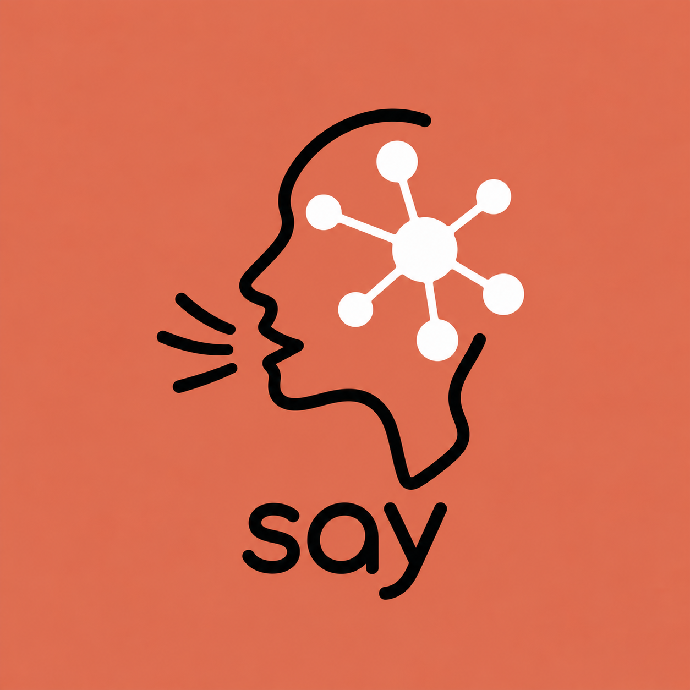

<p align="center">
  
</p>

<div align="center">
  <h1>say</h1>
  <p><b>Make your coding agent reply in ASD-STE100 controlled technical language.</b></p>
  <p>English · <a href="README.zh-CN.md">简体中文</a></p>
  <a href="https://github.com/tianxingjian2406/say/stargazers"></a>
  
  
  
  
  <a href="LICENSE"></a>
</div>

---

**say** makes coding agents reply in ASD-STE100 controlled technical language. It enforces short sentences, active voice, one action per sentence, and a fixed verb set. Rules cover English and Simplified Chinese. The default intensity is 80%.

## The problem it solves

Agent output drifts. Compound sentences grow, passive voice spreads, and dummy verbs (`utilize`, `initiate`, `commence`, `leverage`) blur every step. You reread a reply twice before you can act on it. ASD-STE100, the controlled-language standard from aviation maintenance, removes that friction. say ports it to your terminal and exempts AI, CS, and math terms from the lock, so `tensor`, `gradient`, and `backpropagation` stay untouched.

## Three intensity tiers

| Tier | Alias | Sentence caps | Voice | Vocabulary |
| --- | --- | --- | --- | --- |
| 60% | `lite` | EN <=25w proc, <=30w desc. CN <=35/45 chars. | >=80% active | Standard terms. No hedging. |
| **80% (default)** | `standard` | EN <=20w proc, <=25w desc. CN <=25/35 chars. | 100% active. 1 action per sentence. | Controlled verbs. 20% AI/CS/math exemption. |
| 100% | `strict` | EN <=20w/25w. CN <=22/30 chars. Max 6 sentences per paragraph. | 100% active. Max 3-noun clusters. | One word, one meaning. Locked for the whole reply. |

## Works with 21 agents plus the AGENTS.md family

| Harness | Rules load from | Skills | `/say` command |
| --- | --- | --- | --- |
| Claude Code | plugin hooks: session start, every turn, reply gate, subagents | yes | yes |
| ZCode | plugin hooks, same as Claude Code | yes | yes |
| Codex CLI | `~/.codex/AGENTS.md` block | yes | yes (prompts) |
| OpenCode | `~/.config/opencode/AGENTS.md` block | yes | yes |
| Hermes Agent | `~/.hermes/skills/`, project `AGENTS.md` | yes | ask: `say 60` |
| pi | `~/.pi/agent/AGENTS.md` block | yes | ask: `say 60` |
| Gemini CLI | `~/.gemini/GEMINI.md` block | no | yes (TOML) |
| Qwen Code | `~/.qwen/QWEN.md` block | no | yes (TOML) |
| iFlow CLI | `~/.iflow/IFLOW.md` block | no | yes (TOML) |
| Cursor | `.cursor/rules/say.mdc` | no | no |
| Windsurf | `.windsurf/rules/say.md` | no | no |
| Cline | `.clinerules/say.md` | no | no |
| Roo Code | `.roo/rules/say.md` | no | no |
| Kilo Code | `.kilocode/rules/say.md` | no | no |
| Goose | `~/.config/goose/goosehints` | no | no |
| Crush | `~/.config/AGENTS.md`, project `CRUSH.md` | no | no |
| Amp | project `AGENTS.md` | no | no |
| Droid (Factory) | project `AGENTS.md` | no | no |
| Kimi CLI | project `AGENTS.md` | no | no |
| GitHub Copilot | `.github/copilot-instructions.md` | no | no |
| Trae | `.trae/rules/say.md` | no | no |

Every harness that reads [AGENTS.md](https://agents.md) also works: Zed, Jules, Warp, VS Code, Junie, Devin, Aider. Install with `--project` and the block lands in your project `AGENTS.md`.

On Claude Code and ZCode, hooks enforce the tier end to end. Session start injects the rules. Every turn re-anchors them. A reply gate audits each finished reply, and a reply below the tier gets one forced rewrite. Subagents inherit the tier. Everywhere else, the rules load at session start, and the `/say` command reloads them on call.

## Install

### Automatic install

One installer covers all 21 harnesses in the table above. It needs Node.js 14 or newer:

```bash
git clone https://github.com/tianxingjian2406/say
node say/scripts/install.js <agent>   # one agent: codex, gemini, cursor, ...
node say/scripts/install.js all       # every harness on your machine
node say/scripts/install.js --list    # all supported agents
```

Claude Code and ZCode can instead install the full plugin, hooks included:

```bash
claude plugin marketplace add tianxingjian2406/say
claude plugin install say@say
```

Every install copies the same three things: the `say` and `say-check` skills, the slash commands in your harness's format, and one marked rule block. Options:

- `--tier 60|80|100` sets the block intensity. Default 80.
- `--project` writes into the current project (`.cursor/rules/say.mdc`, `GEMINI.md`, `AGENTS.md`, and so on) instead of your home directory.
- `--uninstall` removes the skills, commands, and blocks. Your own config lines stay.
- `--dry-run` prints every action and writes nothing.

On hook harnesses, the default tier also follows this priority: env `SAY_DEFAULT_MODE` > repo `.say.json` > user config > 80%.

### Manual install

Copy the same three things by hand:

1. Rules. Copy the marked block from [`AGENTS.md`](AGENTS.md) into your harness instructions file (`CLAUDE.md`, `AGENTS.md`, `GEMINI.md`, or its rules directory).
2. Skills. Copy `skills/say` and `skills/say-check` into your harness skills directory.
3. Commands. Copy `commands/say.md` and `commands/say-check.md`, or their `.toml` twins for the Gemini family, into your harness commands directory.

The repo also ships ready-made bundles for every harness (`.claude/`, `.zcode/`, `.codex-plugin/`, `.cursor/`, and more), generated by `node scripts/install.js embed`. Copy the bundle for your harness into your home directory or project root.

## Commands

| Command | Effect |
| --- | --- |
| `/say` or `/say 80` | switch to 80% standard |
| `/say 60` / `/say lite` | switch to 60% lite |
| `/say 100` / `/say strict` | switch to 100% strict |
| `/say off` | disable for this session |
| `/say status` | report the active tier |
| `/say default <60\|80\|100\|off>` | persist the startup tier (hook agents) |
| `/say-check [text]` | score the text or your last reply, then rewrite it |

## Scoring

`/say-check` rates text on five weighted metrics: sentence length 25%, active voice 25%, controlled vocabulary 20%, single instruction per sentence 15%, pronoun clarity 15%. Pass mark: 80%. The linter also runs standalone:

```bash
node scripts/say-linter.js --text "对模型进行训练之前必须先读取配置文件并初始化权重矩阵"
```

## Repository layout

```text
say/
├── .claude-plugin/       plugin manifest + marketplace entry
├── hooks/                session, turn, and reply-gate hooks (Claude Code, ZCode)
├── skills/               say + say-check, portable SKILL.md
├── commands/             slash commands, .md and .toml
├── scripts/              installer, embed mode, quantitative linter
├── tests/                npm test, 11 suites
├── AGENTS.md ...         generated rule files and harness bundles
└── .codex-plugin/ ...    rerun `node scripts/install.js embed` after edits
```

## Contributing

See [CONTRIBUTING.md](CONTRIBUTING.md). It covers the dev loop and the commit message convention.

## License

MIT
